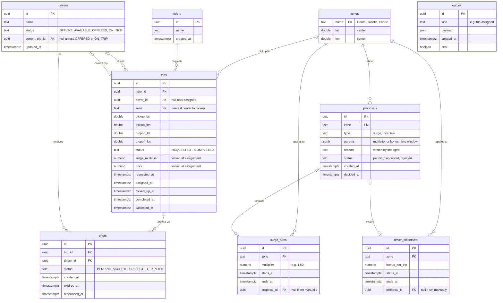

# `core` database schema after the trip domain

This is the `core` PostgreSQL database once the trip domain + matching work is done. `core` is the only service that writes it. The other services learn about changes through events (outbox → RabbitMQ). The `agent` and `activity` databases belong to other services and aren't affected by this work.

Scope and reasoning: [trip-domain-scope.md](trip-domain-scope.md).

## What changes compared to today

| Table | Change |
|---|---|
| `zones` | **New.** The three existing zone names (Centru, Iosefin, Fabric) plus a center coordinate each |
| `observations` | **Removed** once the stats worker computes real numbers. Its made-up demand / drivers / wait values go away |
| `riders`, `drivers`, `trips`, `offers` | **New.** The trip domain |
| `surge_rules`, `driver_incentives` | **New.** What an approved proposal creates |
| `proposals` | **Changed.** Now references `zones`, and gets `type`, `params`, `decided_at` |
| `outbox` | Unchanged |

## Diagram



## Tables

### `zones`
The city's areas. A point belongs to the zone with the nearest center. Used to label trips for stats and to scope surge rules and incentives.

### `riders`
Kept minimal. Riders are mostly created by the simulator.

### `drivers`
The driver's availability is the state matching fights over. `status` moves:

`OFFLINE → AVAILABLE → OFFERED → ON_TRIP → AVAILABLE`

From `OFFERED` it goes back to `AVAILABLE` on a reject or expiry. Positions are not stored here: they live in the location service.

### `trips`
One row per ride request. `status` moves:

`REQUESTED → OFFERED → ASSIGNED → PICKED_UP → COMPLETED`

Side exits: `CANCELLED` (rider cancels before pickup) and `UNMATCHED` (no driver accepted). `OFFERED` can fall back to `REQUESTED` when an offer is rejected or expires. Each step has its own timestamp, which is what the stats worker turns into wait times.

### `offers`
One row per attempt to give a trip to a driver. A trip can have several offers (one per driver tried), but only one pending at a time.

### `surge_rules` and `driver_incentives`
Created when an operator approves a proposal (or set manually). Pricing reads the active surge rule for the pickup zone when a trip is assigned.

### `proposals`
Written by the agent through MCP. Approving one creates the matching surge rule or incentive in the same transaction.

### `outbox`
Unchanged from today. Every state change above writes its event here in the same transaction, and the publisher sends it to RabbitMQ.

## Constraints that back up the concurrency guarantees

These make the double-booking states impossible at the database level, even if application code has a bug:

```sql
-- a driver has at most one active trip
CREATE UNIQUE INDEX one_active_trip_per_driver
    ON trips (driver_id) WHERE status IN ('ASSIGNED', 'PICKED_UP');

-- a driver holds at most one pending offer
CREATE UNIQUE INDEX one_pending_offer_per_driver
    ON offers (driver_id) WHERE status = 'PENDING';

-- a trip is offered to at most one driver at a time
CREATE UNIQUE INDEX one_pending_offer_per_trip
    ON offers (trip_id) WHERE status = 'PENDING';

-- states are a closed set
ALTER TABLE drivers ADD CHECK (status IN ('OFFLINE', 'AVAILABLE', 'OFFERED', 'ON_TRIP'));
ALTER TABLE trips   ADD CHECK (status IN ('REQUESTED', 'OFFERED', 'ASSIGNED', 'PICKED_UP',
                                          'COMPLETED', 'CANCELLED', 'UNMATCHED'));
ALTER TABLE offers  ADD CHECK (status IN ('PENDING', 'ACCEPTED', 'REJECTED', 'EXPIRED'));
```

Indexes for the hot queries:

```sql
CREATE INDEX trips_zone_requested   ON trips (zone, requested_at);   -- stats and agent reads
CREATE INDEX offers_pending_expiry  ON offers (expires_at) WHERE status = 'PENDING';  -- expiry sweeper
CREATE INDEX drivers_available      ON drivers (status) WHERE status = 'AVAILABLE';
```
