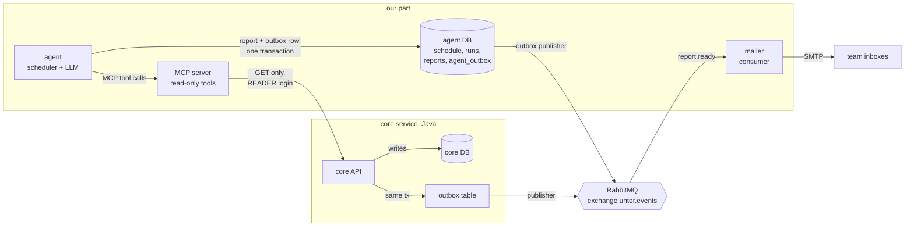

# Surge & incentive agent: implementation plan

Status: **implemented (steps 1–9, 2026-11-05)**; unit tests and the Compose dev stack checks
(migrations, integration, read-only, stats, browser) pass, plus a live gpt-5-nano report and an
approval that created and approved the incentive in core. Not yet run on the cluster. Open questions
remain in section 10. Plan date: 2026-11-03.

Fixed during the stack test (2026-11-05): `net_flow` is now `arrivals − completed`, not
`arrivals − requests`. Cancelled and open requests had counted as a drain, which proposed a 10 RON
bonus where no driver had left. The model prompt now asks for UTC on times, plain words instead of
field names, and no hedging against the rules' proposals.

This plan covers our part of Unter: an MCP server + agent that analyse trip data, propose
**surge rates** (price multipliers for busy zones) and **driver incentives** (per-trip bonuses for
drivers working those zones), gather the proposals into a **report**, and email it to the team on a
**configurable schedule**, using **RabbitMQ** for delivery.

It is based on [db-schema.md](db-schema.md), [core-api-contract.md](core-api-contract.md),
[database-migrations.md](database-migrations.md), the Flyway migrations `V1`–`V6` and the existing
Python services (`mcp_server.py`, `agent.py`, `worker.py`).

---

## 1. Hard requirement: the agent never writes to the `core` database

This requirement drives the design, so it comes first.

### 1.1 What "write" includes

The agent must not write to `core` **directly or indirectly**:

| Path | Direct DB write? | Writes to `core` anyway? | Allowed? |
|---|---|---|---|
| `INSERT/UPDATE/DELETE` on `core` | yes | yes | **no** |
| `POST /proposals` on the `core` API | no | **yes**: core inserts into `proposals` + `outbox` | **no** |
| `PATCH /proposals/{id}` | no | **yes**: may create `surge_rules` / `driver_incentives` | **no** |
| `SELECT` through a read-only role | no | no | yes |
| `GET` endpoints of `core` | no | no | yes |
| Publishing a message to RabbitMQ | no | no | yes |
| Writing run bookkeeping to its **own** `agent` database | no | no | yes (see 1.3) |

**Consequence for existing code:** the `create_proposal` tool in
`services/python/unter/mcp_server.py` calls `POST /proposals`, which writes to `core`. It must be
**removed** from the MCP server (or moved to a separate, human-only service). The agent's output
becomes a report message, not rows in `core.proposals`.

### 1.2 How we enforce it (defence in depth)

Prompt instructions alone aren't enough. Each layer below blocks writes even if the layer
above fails:

1. **No write tools exist.** The MCP server exposes only read tools. Nothing the model can call
   is able to issue a write.
2. **No free-form SQL.** Tools run fixed, parameterised queries. The model chooses a zone name,
   a time window and a bucket size. It never sends SQL text.
3. **No database access at all** (option B, decided 2026-11-03): the MCP server has no database
   credentials and no network route to Postgres. It reads `core` only through its HTTP API.
4. **Read-only API login** (*implemented*): `core` accepts two logins. `SERVICE` (gateway) can do
   anything. `READER` (`READER_USERNAME`/`READER_PASSWORD`) gets **403 `read_only`** for anything
   but `GET`/`HEAD`, in `Auth.java`, before any controller or the database is reached. The MCP
   container holds **only** the `READER` login. The agent and gateway use it to call the MCP
   server. The only core client in the MCP code is `core_read()` in `unter/common.py`, which
   can only send `GET`. The write tool `create_proposal` has been removed.
5. **Network policy.** The agent pod keeps no route to `core:8080` (already the case). Only the
   gateway and the MCP pod reach `core`.
6. **Tests** (*implemented*):
   - `scripts/readonly-check.py` (`make readonly-check`, also in CI) runs inside the MCP
     container. It checks that `READER` can read, that 9 write attempts (`POST`/`PATCH`/`PUT`/
     `DELETE` on proposals, riders, drivers, trips, offers) all get 403, and that the proposals
     list is unchanged afterwards. It also checks that the container doesn't hold the `SERVICE`
     login.
   - `tests/test_mcp_read_only.py` fails if the MCP server exposes a tool that isn't on the
     reviewed read-only allowlist, or if `core_read()` ever sends anything but a `GET` with the
     `READER` login.

   Remaining gap: the agent container still has the `SERVICE` login, because the gateway uses
   it to call the agent's own endpoints (`/run`, `/schedule`, `/decisions`). The agent code never
   calls `core`, and in the cluster the network policy blocks agent → core
   (`tests/test_deploy_manifests.py` checks this). In local Compose there's no such policy. If we
   want to close this, give the gateway→agent hop its own login. The mailer holds no `SERVICE`
   login: it has no private endpoints.

### 1.3 The agent's own database

`agent` (the Alembic-managed DB with `schedule` and `runs`) belongs to the agent service. We read
"the agent must not write to the database" as being about **`core`**. The agent service still needs
somewhere to store its schedule, run history and generated reports. **Confirmed (2026-11-05,
section 10, Q1): the agent may write to its own `agent` DB; only `core` is off-limits.**

---

## 2. Target architecture



**Flow of one report run:**

1. The scheduler in `agent` fires (cron + timezone from the `agent` DB, as it does today).
2. The agent calls MCP read tools to get per-zone metrics for the configured **analysis window**
   (e.g. the last 24 h, in 1 h buckets).
3. A **deterministic rules engine** (plain Python, no LLM) turns metrics into candidate
   proposals with exact numbers.
4. The LLM writes the human-readable parts: a per-proposal `reason` and an executive summary.
   It can't change the numbers (section 6.3).
5. The agent stores the report and an outbox row **in one transaction in the `agent` DB**.
6. An outbox publisher in `agent` sends `report.ready` to RabbitMQ and marks the row sent.
7. The `mailer` consumes `report.ready`, renders the email and sends it to the configured
   recipients. It records the report id so a duplicate delivery doesn't send a second email.

This reuses the outbox pattern `core` already uses (`Outbox.java` + `Events`), so delivery is
reliable: a report is never emailed without being stored, and is never lost if RabbitMQ is down
when it's generated.

---

## 3. Reading the data: direct read-only SQL vs. `core` API

The current `GET` endpoints don't support analysis well:

- `GET /trips` returns at most **200** rows, newest first, with no time filter. A 24 h window
  in a busy simulation is more than that.
- There is no endpoint for offers, for historical driver supply, or for aggregates.
- The contract says *"Nobody else touches its database"*. Reading it directly changes that.

| Option | Pros | Cons |
|---|---|---|
| A. Read-only role on `core` DB | Full history; aggregation in SQL using the existing `trips_zone_requested` index; no Java work | Couples us to `core`'s schema; Andy has to agree to the new role and network rule |
| B. New read-only aggregate endpoints in `core` (`GET /stats/zones?from=&to=&bucket=`) | Keeps "core owns its DB"; schema can change behind the API | Java work in a service we don't own; slower to iterate |
| C. Build our own read model from RabbitMQ events | Fully decoupled; real-time | No history before the queue existed; duplicates the worker; most work |

**Decision (2026-11-03): B.** The aggregation queries in section 4 move into new read-only `GET`
endpoints in `core` (e.g. `GET /stats/zones?from=&to=&bucket=`, `GET /stats/flows`,
`GET /stats/offers`), and the MCP tools call them through `core_read()`. Option C can still be
added later for real-time signals, e.g. reacting to a spike in `trip.unmatched` between scheduled
runs.

---

## 4. Metrics (what the MCP tools compute)

All per **zone** × **time bucket**, over a window `[from, to)`. `trips.zone` is the **pickup**
zone. Since we also care about trips *to* a zone, the **dropoff zone** is computed the same way
core does it: the nearest zone center, by straight-line distance from `(dropoff_lat, dropoff_lon)`
to `zones.lat/lon`.

| Metric | Source | Definition |
|---|---|---|
| `requests` | trips | `count(*)` by `requested_at` in bucket, by pickup zone |
| `arrivals` | trips | completed trips whose **dropoff** zone is the zone |
| `completed` | trips | `status = 'COMPLETED'` |
| `unmatched_rate` | trips | `UNMATCHED / requests`. The strongest "not enough drivers" signal |
| `cancel_rate` | trips | `CANCELLED / requests`. Often caused by long waits |
| `avg_wait_s`, `p90_wait_s` | trips | `assigned_at − requested_at` for assigned trips |
| `offers_per_trip` | offers | `count(offers) / count(distinct trip_id)` |
| `offer_reject_rate`, `offer_expiry_rate` | offers | share of offers `REJECTED` / `EXPIRED`. High means drivers avoid the zone |
| `available_drivers_now` | drivers | `status='AVAILABLE' AND position_updated_at > now() - 2 min`, by `drivers.zone` |
| `demand_supply_ratio` | derived | `requests per hour / max(available_drivers, 1)` |
| `net_flow` | derived | `arrivals − completed`: completed trips ending in the zone minus completed trips starting there. Negative means the zone drains drivers. (Was `arrivals − requests` until testing showed cancelled and open requests counting as a drain.) |
| `active_surge`, `active_incentive` | surge_rules, driver_incentives | what's in effect now, for context and to avoid duplicates |

**As built (step 2):** `GET /stats/zones` returns the trip and offer metrics per zone × bucket,
including `arrivals`. `GET /stats/flows` returns the pickup→dropoff matrix, and `GET /stats/supply`
returns current drivers and waiting trips per zone. `demand_supply_ratio` and `net_flow` are
derived in Python from those. `active_surge`/`active_incentive` come from the existing
`GET /surge`/`GET /incentives`. The `proposals` table isn't used by the analysis.

**Limitation:** `drivers` holds only the *current* status and zone, so historical supply per
bucket can't be computed from `core`. Options: (a) only use current supply; (b) estimate past
supply from `offers` (distinct drivers offered trips in the zone/bucket); (c) later, a read model
from `driver.status_changed` / `driver.zone_changed` events. Start with (a) + (b).

Example query (pickup side, hourly buckets):

```sql
SELECT zone,
       date_trunc('hour', requested_at)                         AS bucket,
       count(*)                                                 AS requests,
       count(*) FILTER (WHERE status = 'COMPLETED')             AS completed,
       count(*) FILTER (WHERE status = 'UNMATCHED')             AS unmatched,
       count(*) FILTER (WHERE status = 'CANCELLED')             AS cancelled,
       avg(extract(epoch FROM assigned_at - requested_at))      AS avg_wait_s,
       percentile_cont(0.9) WITHIN GROUP
         (ORDER BY extract(epoch FROM assigned_at - requested_at)) AS p90_wait_s
FROM trips
WHERE requested_at >= %(from)s AND requested_at < %(to)s
GROUP BY zone, bucket
ORDER BY zone, bucket;
```

---

## 5. MCP server design (`services/python/unter/mcp_server.py`)

All tools are read-only and validate their arguments: zone must exist, window at most 7 days,
bucket one of `15m | 1h | 6h | 1d`. They return compact JSON aggregates, never raw trip lists,
which keeps the model's context small and avoids exposing per-rider data.

| Tool | Arguments | Returns |
|---|---|---|
| `list_zones` | – | zones with centers |
| `zone_demand` | `from, to, bucket, zone?` | the trip metrics from section 4, per zone × bucket |
| `zone_flows` | `from, to, zone?` | pickup→dropoff zone matrix (origin/destination counts) |
| `offer_stats` | `from, to, zone?` | offers per trip, reject/expiry rates |
| `driver_supply` | `zone?` | available / offered / on-trip drivers now, per zone |
| `active_rules` | – | current surge rules and incentives per zone |
| `zone_snapshot` | `from, to` | **one-call summary** combining the above per zone. The agent's main tool |

Remove: `create_proposal` (writes to core) and, once the stats replace it,
`list_observations` (deprecated endpoint).

Implementation notes:

- All reads go through `core_read()` with the `READER` login (step 1). The metrics are computed
  by the new `core` stats endpoints, not in Python.
- The MCP endpoint itself requires the `READER` login (`BasicAuth(kind='READER')`).

**As built (step 3):**

- Tool times are `start`/`end` (`from` is a Python keyword), ISO-8601 with an offset, default the last
  24 h. Checked in Python before `core` is called: window ≤ 7 days, end cut at now, bucket in the
  enum, zone in `GET /zones`, and at most 200 buckets per zone (e.g. 7 days needs `1h` or larger).
  Bad arguments and `core` 400s come back to the model as tool errors it can correct.
- `zone_demand`, `offer_stats` and `zone_flows` leave out empty buckets/pairs (the result says to
  count them as zero), so results stay small.
- `offers_per_trip` is offers per **requested** trip in the bucket (core doesn't return distinct
  offered trips).
- `zone_snapshot` per zone: window totals and rates; `avg_wait_s` and `avg_price` weighted by
  assigned/completed trips; `worst_p90_wait_s` (worst hourly p90: percentiles can't be summed);
  `peak_bucket` (busiest hour); `max_drivers_offered_per_bucket` (supply estimate, option (b) in
  section 4); `supply_now`; `demand_supply_ratio`; `net_flow`; active surge and incentive. It doesn't
  include flows; `zone_flows` has them.

---

## 6. Proposal logic

### 6.1 Rules engine (deterministic, `unter/analytics/rules.py`)

The thresholds below are starting values, kept in one config object so the team can tune them:

**Surge** (rider pays more, which tempers demand and attracts drivers):

```
pressure = weighted score of:
    demand_supply_ratio  (weight 0.4)
    unmatched_rate       (weight 0.3)
    p90_wait / target    (weight 0.2, target = 180 s)
    cancel_rate          (weight 0.1)

if requests >= MIN_SAMPLE (e.g. 20) and pressure >= 1.0:
    multiplier = clamp(1.0 + 0.25 * (pressure - 1.0) * 4, 1.10, 2.00)  -- rounded to 0.05
```

**Incentive** (drivers earn more, riders pay the same):

```
if net_flow < 0 (zone drains drivers) or offer_reject_rate + offer_expiry_rate >= 0.4
   or (unmatched_rate >= 0.15 and available_drivers_now <= 2):
    bonus_per_trip = clamp(round(2 + 10 * shortage_score, 0.5), 1.00, 10.00) RON
```

**Pairing:** where a zone gets a surge, the rules usually also propose an incentive for the same
window. This matches the brief: drivers who take trips in surge zones earn more.

**Guards:**
- Skip zones below `MIN_SAMPLE` requests, so we don't act on noise.
- Skip if an equal or stronger rule is already active for that window.
- At most one surge and one incentive per zone per report.
- Window: `starts_at` = next full hour, `ends_at` = `starts_at + duration` (default 2 h),
  matching the hour-of-day pattern that triggered it.

**As built (step 4)**, where it differs from the sketch above:

- **Signals are normalised** before weighting: each one is divided by its target, so 1.0 means
  "at target", and capped at 3 so one extreme signal can't decide alone. Targets: 3 requests/h per
  available driver, 10 % unmatched, p90 wait 180 s, 15 % cancelled. The sketch added raw rates
  (0–1) to a ratio in different units. With normalised signals its multiplier formula
  `1 + 0.25·(p−1)·4` reduces to `p`, so `multiplier = clamp(pressure, 1.10, 2.00)` rounded to 0.05.
- **p90** is `worst_p90_wait_s` from the snapshot (the worst hourly p90).
- **Drain** fires at `net_flow ≤ −20 % of requests`, not at any negative value, to avoid noise.
- **`shortage_score`** = the largest of drain share, reject + expiry rate and unmatched rate, capped
  to 0–1. Bonus = `2 + 10·score` RON, rounded to 0.5, between 1 and 10.
- **Pairing:** a surge zone with no incentive trigger still gets one, scored `pressure − 1`.
  This can be turned off with `pair_incentive_with_surge`.
- **"Already active"** means an active rule at least as strong that lasts until the proposed one
  would end. A weaker rule, or one ending sooner, doesn't block a proposal.
- **Window:** next full UTC hour + 2 h. Matching the hour-of-day pattern isn't done yet.
- **Output:** `{generated_at, window, proposals, skipped}`. Each proposal has `id`
  (`"<zone>:<type>"`, which the LLM must echo back), `zone`, `type`, `params` (the
  `POST /proposals` shape), `rule` (what fired) and `metrics`. `skipped` lists zones dropped for a
  low sample or an active rule, with the reason.
- Every candidate passes `validate.check(require_reason=False)` before it is returned. Step 5
  checks again with the reason.

### 6.2 Stay inside the `core` API limits

Even though the agent doesn't create proposals in `core`, each proposal in the report uses the
exact `type`/`params` shape of `POST /proposals`, so an operator can approve it later without
changing anything:

- `surge`: `{"multiplier": 1.0–3.0, "starts_at", "ends_at"}`
- `incentive`: `{"bonus_per_trip": 0–20, "starts_at", "ends_at"}`
- at most 2 decimals, `ends_at > starts_at`, `ends_at` in the future, `zone` exists.

A shared validator (`unter/analytics/validate.py`) checks this before anything leaves the agent.

### 6.3 Role of the LLM

The LLM **explains**. It doesn't calculate:

- Input: the metrics for each candidate proposal plus the rule that fired.
- Output (structured, Pydantic schema): `reason` per proposal (≤ 1000 chars, the `core` limit)
  and a `summary` for the report.
- After the model responds, the agent checks that it returned exactly the candidate ids it was
  given. Numbers in the final report always come from the rules engine, not from model text.
- In `AGENT_MODE=fake`, reasons are filled in from templates, so CI never calls OpenAI.
- Keep the existing budget controls (`MAX_DAILY_RUNS`, advisory lock, a request cap like
  `HelloModel`). Raise the per-run model request cap from 2 to a small fixed number, e.g. 4.

---

**As built (step 5):**

- **Pipeline** (`report.build`):
  1. Reads `zone_snapshot` via MCP for the last `window_hours` (from `report_settings` since
     step 6; default 24).
  2. Runs `rules.propose()`.
  3. Makes one model call: Agno, `output_schema=Explanation` (strict JSON schema), **no tools**,
     `CappedModel` with at most 2 requests and 4000 output tokens.
  4. Checks every proposal with `validate.check` (reason required).
- **The model sees** only the candidates (id, zone, type, params, rule, metrics), the skipped list
  and the window, not the full snapshot. It returns `{summary, reasons: [{id, reason}]}`.
- **Its text is used only if** it returns exactly the given ids, each once, every reason passes the
  validator, and the summary is non-blank and ≤ 2000 characters. Otherwise, or on any provider
  error, the report uses template text: `explained_by: "template"`, and `note` gives the cause
  (our own rejection message, or only the exception class for provider errors). A model problem
  never fails the run. Failing to read the data, or an invalid proposal, still does.
- **No model call** in fake mode or when there are no proposals.
- **Report JSON** (stored in `reports.report` since step 6; the run's `result` holds the summary):
  `{generated_at, window: {from, to, hours}, summary, proposals: [{id, zone, type, params, reason,
  rule, metrics}], skipped, zones, explained_by: "model"|"template", model, note}`. This is the
  shape steps 6–7 build on.
- `list_observations` is removed from the MCP server. `HelloModel` became `CappedModel`.
- **Not done yet:** the dashboard still shows the run result as raw JSON under "hello world"
  wording (step 8).

## 7. Report, schedule and email

### 7.1 New tables in the `agent` DB (Alembic revision `agent_0002`)

```text
report_settings (id=1)
    cron            text         -- when to send, e.g. '0 8 * * 1-5'
    timezone        text         -- IANA, e.g. 'Europe/Bucharest'
    window_hours    int          -- analysis window, e.g. 24
    bucket          text         -- '1h'
    recipients      text[]       -- team emails
    enabled         bool

reports
    id              uuid PK
    run_id          uuid FK runs
    window_from     timestamptz
    window_to       timestamptz
    summary         text
    proposals       jsonb        -- [{zone, type, params, reason, metrics}]
    metrics         jsonb        -- per-zone snapshot used
    created_at      timestamptz

agent_outbox                       -- same pattern as core.outbox
    id uuid PK, seq bigserial, kind text, payload jsonb,
    created_at timestamptz, sent bool
```

The existing `schedule` row can become the report schedule (it already has cron + timezone +
enabled and a dashboard UI). Adding `window_hours`, `bucket` and `recipients` to it is the least
work. "Configurable time window" covers both **when** the report goes out (cron) and **which
period** it analyses (`window_hours`).

Recipients are configured in the dashboard/API (`PUT /schedule`) and validated as email
addresses. They are never hard-coded.

**As built (step 6):**

- **`report_settings` is its own one-row table** (`window_hours` 1–168, default 24; `recipients`
  `text[]`). `schedule` keeps cron, timezone and enabled, so existing schedule rows are untouched
  and `check-migrations.py` still compares them before and after upgrade. `bucket` was left out
  because the pipeline always uses hourly buckets.
- **Settings API:** `GET`/`PUT /schedule` include `window_hours` and `recipients`. Leaving them out
  of a `PUT` keeps the stored values, so the current dashboard doesn't erase them. Recipients are
  trimmed, lower-cased and de-duplicated, at most 20. Each must be a plain address: no spaces,
  commas, quotes or angle brackets, so it can't inject mail headers.
- **`reports`:** `id`, `run_id` (unique, FK `runs`), `window_from`, `window_to`, `report` (the
  whole report JSON), `created_at`. `GET /reports` (gateway `/api/reports`) lists the newest 20,
  with `published` = the `report.ready` event was confirmed by RabbitMQ.
- **One transaction per run:** the report row, the `agent_outbox` row and the run's `completed`
  status are committed together. If any part fails it is all rolled back and the run is
  `failed`. `runs.result` now holds the summary plus a pointer to the report.
- **Publisher** (`unter/outbox.py`): a background task in the agent, polling every second like
  core's. It publishes to `unter.events` with the core envelope `{id, kind, data}`, persistent
  messages and publisher confirms. A row is marked sent only after RabbitMQ confirms it, one
  commit per row. If RabbitMQ is down, rows wait and are retried every 5 s. Delivery is at least
  once.
- **Event data:** the whole report plus `report_id`, `run_id`, `source` and `recipients`, so the
  mailer needs no database access. Manual runs publish too; the mailer can use `source` to tell
  them apart.
- **The agent doesn't declare `unter.reports`.** Until the mailer (step 7) declares its queue,
  `report.ready` only reaches `unter.activity` (bound to `#`). If a report must be emailed even
  when the mailer starts later, step 7 should declare the queue before reports go out.
- **Deployment:** the agent gets `RABBITMQ_PASSWORD` (compose + manifest), depends on RabbitMQ in
  Compose, and the network policy allows agent → rabbitmq:5672. The core API contract lists
  `report.ready`.

### 7.2 RabbitMQ messages

Published by the agent's outbox publisher to the existing `unter.events` topic exchange, in the
same envelope `core` uses:

```json
{"id": "<event id>", "kind": "report.ready",
 "data": {"report_id": "…", "window_from": "…", "window_to": "…",
          "recipients": ["…"], "summary": "…", "proposals": [ … ]}}
```

- Routing key `report.ready`. The mailer declares its own durable queue `unter.reports`, bound to
  `report.*`. It must not share `unter.activity` (contract rule).
- The existing worker binds `#`, so reports also show up in the activity feed for free.
- Delivery is at-least-once: the mailer stores sent `report_id`s and skips repeats.

### 7.3 Mailer (`unter/mailer.py`, new `SERVICE_MODULE=mailer`)

- `aio_pika` consumer, structured like `worker.py`.
- Renders an HTML + plain-text email (Jinja2). Contents: summary, a per-zone table of key
  metrics, proposals grouped by zone (type, value, window, reason), and a line saying approval
  happens in the dashboard.
- SMTP settings come from env (`SMTP_HOST`, `SMTP_PORT`, `SMTP_USER`, `SMTP_PASSWORD`,
  `MAIL_FROM`, STARTTLS). For local dev, add **Mailpit** to `compose.dev.yaml` to catch
  emails without sending real ones.
- If sending fails, the message is `nack`ed and requeued with a delay, e.g. a dead-letter queue
  with TTL. After N attempts it is parked and shown in the dashboard.

**As built (step 7):**

- **`unter/mailer.py`** (`SERVICE_MODULE=mailer`) declares durable `unter.reports`, bound to
  `report.ready` only (not `report.*`), and `unter.reports.retry`. The retry queue has no consumer:
  its messages expire after `MAIL_RETRY_SECONDS` (60) and are dead-lettered back into
  `unter.reports`. Prefetch is 1.
- **Delivery state is `report_deliveries` in the agent DB** (migration `agent_0003`), not a separate
  mailer database. `init-db.sh` only runs on a fresh Postgres volume, so a new database wouldn't
  exist on current deployments. The mailer uses the agent's DB login; the agent still runs the
  migrations. `GET /reports` shows each report's `delivery` (status, attempts, last error, sent
  time). Statuses:
  - `sending`, then `sent`
  - `failed`: will be retried
  - `parked`: after `MAIL_MAX_ATTEMPTS` (5) failures; no more retries
  - `skipped`: no recipients
  - `not_configured`: no `SMTP_HOST`

  Errors are stored as class + SMTP code only, never server text or addresses.
- **Duplicates:** an atomic upsert claims each attempt, and nothing is sent again once a report is
  `sent`, `parked`, `skipped` or `not_configured`. A crash between sending and recording `sent`
  can still send twice; that's accepted (at-least-once).
- **Database or broker trouble:** the message is requeued after a 5 s pause. An unreadable message
  is dropped.
- **Email:** standard library (`email`, `smtplib` in a thread), not Jinja2, so no new dependency.
  Plain text + HTML with every value escaped. It contains:
  - the window and summary
  - proposals grouped by zone (value, time window in UTC, reason)
  - the skipped zones
  - a per-zone metrics table (requests, per hour, unmatched, cancelled, worst p90 wait, net flow,
    drivers now, demand/supply, active rules)
  - a line saying nothing is applied until someone approves it in the dashboard

  The subject gives the count, and marks manual runs (which are emailed too).
- **SMTP settings:** `SMTP_HOST`, `SMTP_PORT`, `SMTP_SECURITY` (`starttls` default, `ssl`, or
  `none` for local only), `SMTP_USER`, `SMTP_PASSWORD`, `MAIL_FROM`. An invalid `SMTP_SECURITY`
  stops the service at startup.
- **Mailpit:** `compose.dev.yaml` adds `axllent/mailpit` (UI on `127.0.0.1:8025`) and points the
  mailer at it.
- **Deployment:**
  - new `mailer.yaml` (in the kustomization)
  - SMTP values are optional Secret keys (`sync-secrets.py` copies them when set)
  - network policy: mailer → rabbitmq and postgres, plus egress to public IPs on 465/587
- Still open: Q4 (production SMTP provider and sender address).

### 7.4 Approving proposals (out of the agent's hands)

A person turns a reported proposal into a real rule. A dashboard button calls `POST /proposals`
followed by `PATCH /proposals/{id}`, or a single new "apply" endpoint in `core`. Either way the
write happens under the **operator's** credentials through the gateway, never the agent's. Then
`core` writes `surge_rules` / `driver_incentives` and emits `surge.changed` / `incentive.changed`
through its outbox, as it already does.

---

**As built (step 8):**

- **Approve flow:** `POST /api/reports/{report_id}/decisions` `{proposal_id, decision}` in the
  gateway (admin login + CSRF header, like every `/api` call). The browser only names the
  proposal.
  1. The gateway asks the agent to **claim** it (`POST /decisions`, internal only: not
     forwarded from `/api`). The agent looks the proposal up in the stored report and returns it
     with its numbers.
  2. The claim fails with 409 if the proposal was already decided or, for an approval, if its
     `ends_at` has passed.
  3. To approve, the gateway calls core `POST /proposals` (zone/type/params from the report; the
     reason gets a "(Unter report …, Iosefin:surge)" suffix, cut to 1000 characters) and
     `PATCH /proposals/{id}` approved, with the gateway's service login, as for every admin action.
  4. The gateway records the outcome in the agent: `PUT /decisions`, status `applied`, or `created`
     if the core approval failed (then the operator approves it under Proposals).
  5. If core refuses, the claim is released (`DELETE /decisions`), so the operator can retry.
  6. Rejecting only records the decision; core isn't called.
- **`report_decisions`** (migration `agent_0004`): one row per (report, proposal), with status
  `applying` / `applied` / `created` / `rejected`, plus `core_proposal_id`. `GET /reports` includes
  `decisions`. An `applying` claim older than 2 minutes (the gateway died midway) can be claimed
  again. If core had already created the proposal, that may leave a second core proposal; it is
  rare and visible under Proposals.
- **Dashboard** (`web/`): a new **Reports** view. Each report shows its window, text source, email
  delivery state, summary, and each proposal with its value, time window, reason, rule and
  Approve / Reject (or its decision, or "Expired"). It also lists the skipped zones and has a
  collapsible zone-metrics table.
  - **Overview:** the latest report's summary, the count of open proposals, and **Run report now**.
  - **Schedule & runs:** adds the analysis window (hours) and the recipients (one per line).
  - The hello-world text is gone, and the service-worker cache is bumped to `v2`.
  - Every value is set with `textContent`, never HTML.
  - **Approve** asks for confirmation first.

## 8. Deployment changes

| File | Change |
|---|---|
| `services/core/.../Auth.java` | ✅ second, GET-only `READER` login. Coordinate with Andy |
| `.env.example`, `scripts/init-env.py`, `scripts/sync-secrets.py` | ✅ `READER_USERNAME`/`READER_PASSWORD` (required); `SMTP_*`, `MAIL_FROM` (optional Secret keys) |
| `compose.yaml` | ✅ `READER` login for core, mcp (only login it has), agent, gateway; agent gets `RABBITMQ_PASSWORD`; new `mailer` service (agent DB login, RabbitMQ, SMTP; no `SERVICE` login) |
| `compose.dev.yaml` | ✅ `mailpit` service; mailer pointed at it |
| `deploy/app/*` via `scripts/generate-manifests.py` | ✅ same `READER` env; agent `RABBITMQ_PASSWORD`; new `mailer.yaml` (CPU limit 250m, to keep quota headroom) in the kustomization |
| `deploy/app/network-policy.yaml` | ✅ agent → rabbitmq:5672; mailer → rabbitmq:5672, postgres:5432, public 465/587 |
| `deploy/README.md` | ✅ upgrade order for this release, egress, accounts, verification |
| `services/python/tests/test_deploy_manifests.py` | ✅ manifests match the generator; kustomization complete; every Secret key referenced is synced; network policy allows every configured RabbitMQ/Postgres connection; mcp/agent/mailer/worker can't reach core; mcp/mailer hold no `SERVICE` login; quota keeps headroom |

---

## 9. Work breakdown and order

1. ✅ **Read-only access** (done 2026-11-03): GET-only `READER` login enforced by `core`, MCP
   holds only that login, `create_proposal` removed, tool allowlist test, and the
   "writes must fail" check.
2. ✅ **Stats endpoints in `core`** (done 2026-11-03): `GET /stats/zones`, `/stats/flows`,
   `/stats/supply` in `Stats.java` (read-only transactions), index `V7__stats_indexes.sql`,
   documented in [core-api-contract.md](core-api-contract.md). Checked by
   `scripts/stats-check.py` (`make stats-check`, also in CI), which builds a known scenario
   through the API and verifies the counts.
3. ✅ **MCP tools** (done 2026-11-05): the section 5 tools in `mcp_server.py`, with argument checks and
   derived metrics in `unter/analytics/stats.py`. Tested with a fake `core` in
   `tests/test_mcp_tools.py`; `make stats-check` also runs `zone_snapshot`/`zone_flows` inside the MCP
   container against the real `core`. `list_pending_proposals` removed; `list_observations`
   removed in step 5.
4. ✅ **Rules engine + validator** (done 2026-11-05): `unter/analytics/rules.py` (`propose()` on a
   `zone_snapshot` result) and `unter/analytics/validate.py` (mirrors `Proposals.java`), with
   table-driven tests in `tests/test_rules.py`. See "As built (step 4)" in section 6.
5. ✅ **Agent run** (done 2026-11-05): `hello()` replaced by `unter/report.py`, keeping the
   locks and budgets. Tested in `tests/test_report.py`. See "As built (step 5)" in section 6.3.
6. ✅ **`agent_0002` migration + outbox publisher** (done 2026-11-05). Tested in
   `tests/test_report_delivery.py`, `make migrations-check` and `make integration`. See "As built
   (step 6)" in section 7.1.
7. ✅ **Mailer service** + Mailpit + email templates (done 2026-11-05). Tested in
   `tests/test_mailer.py`, `make migrations-check` and `make integration`. See "As built
   (step 7)" in section 7.3.
8. ✅ **Dashboard** (done 2026-11-05): schedule/window/recipients form, Reports view, approve and
   reject flow. Tested in `tests/test_gateway_decisions.py` and `make integration`. See "As built
   (step 8)" in section 7.4.
9. ✅ **Deployment** (done 2026-11-05): manifests, secrets, network policy and docs (section 8);
   `report.ready` is in `core-api-contract.md`; upgrade order in `deploy/README.md`. Consistency
   is checked by `tests/test_deploy_manifests.py` in CI.

Steps 1–4 can be built and demoed without email or RabbitMQ. Steps 6–7 can run in parallel with
4–5 once the report JSON shape is agreed.

---

## 10. Open questions for the team

1. ~~**"No writes to the database"**~~: **answered 2026-11-05: yes**, the agent may write to its
   own `agent` DB (schedule, runs, reports, outbox, deliveries, decisions). Only `core` is
   off-limits.
2. ~~**Read path**~~: **answered 2026-11-03: option B** (stats endpoints in `core`, no
   database access for the MCP server).
3. **Answered 2026-11-03: our part doesn't use `core.proposals`.** The table stays for now, because approving a proposal is still the only code that creates surge rules and incentives. Removing it is a later decision with Andy. *Original question:* **Should proposals still show up in `core.proposals`?** In this plan, a person creates them
   from the report. If proposals need to appear there automatically, *something other than the
   agent* has to write them, e.g. a small consumer of `report.ready` running under `core`'s own
   authority. That needs agreement on whether it still meets the "agent never writes" rule.
4. **SMTP provider** for production (university SMTP, a transactional mail service, …) and the
   sender address.
5. **Tuning targets**: acceptable p90 wait, maximum surge we're comfortable proposing (the API
   allows 3.0; this plan caps at 2.0), incentive budget.
6. `db-schema.md` links to `trip-domain-scope.md`, which isn't in the repo. Is there extra
   scope in it that we should know about?
